# Capstone Project: Network Design, Reconnaissance, and Securing Data Transmission

## Overview
This project was completed as part of the TechCrush Cybersecurity Track Cohort 8 capstone, in a team of 18. It simulates onboarding as a new IT Security team member at a company that has just deployed a new office network, and validating that network before employees start using it.

The project covers four areas: segmented network design, virtual machine deployment, network reconnaissance, and packet-level traffic analysis, then applies encryption and hashing to a real file transfer to compare what an attacker can see on encrypted vs. unencrypted channels.

**My role:** I was personally involved in the VM setup and connectivity testing, the Nmap reconnaissance against the target host, the Wireshark packet analysis, and the encryption/hashing/secure-transfer exercise. The VLAN network design was built by another team member as part of our shared deliverable.

## Scenario
TechCrush Technologies Ltd. has just finished building a new office network with four departments (Finance, HR, IT, Marketing) and wants the security team to validate it, confirming segmentation works, discovering what's actually exposed on the network, and checking whether sensitive data can be intercepted in transit.

## Tools Used
- Cisco Packet Tracer (network design)
- VirtualBox (Ubuntu target VM, Kali Linux security workstation)
- Nmap (reconnaissance)
- Wireshark (packet capture and analysis)
- OpenSSL, sha256sum (encryption and integrity verification)
- SSH / SCP, netcat (file transfer comparison)

## Skills Demonstrated
VLAN segmentation and access control, virtual lab environment setup, network reconnaissance methodology, protocol-level traffic analysis, encryption vs. hashing (confidentiality vs. integrity), secure vs. insecure data transmission.

---

## Task 1: Network Design (VLAN Segmentation)

Four departments were each placed on their own VLAN (10, 20, 30, 40), with inter-VLAN routing controlled by an ACL on the router. The design requirement was simple to state but meaningful in practice: devices in the *same* VLAN should talk to each other freely; devices in *different* VLANs should not, unless a rule explicitly allows it.

**Why this matters:** VLAN segmentation is a basic but real containment control. If Marketing's workstation gets compromised, segmentation is what stops that compromise from reaching Finance's systems by default, the attacker would have to defeat the ACL, not just be on "the network."

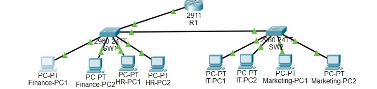
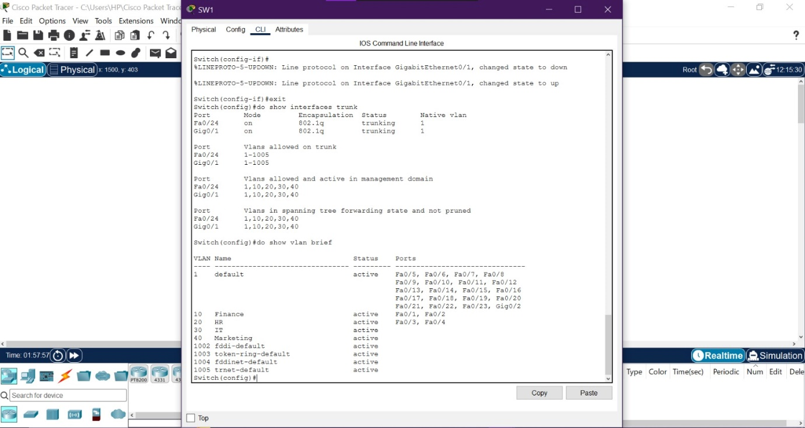
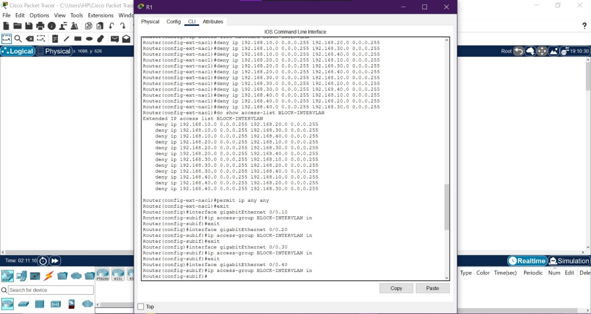
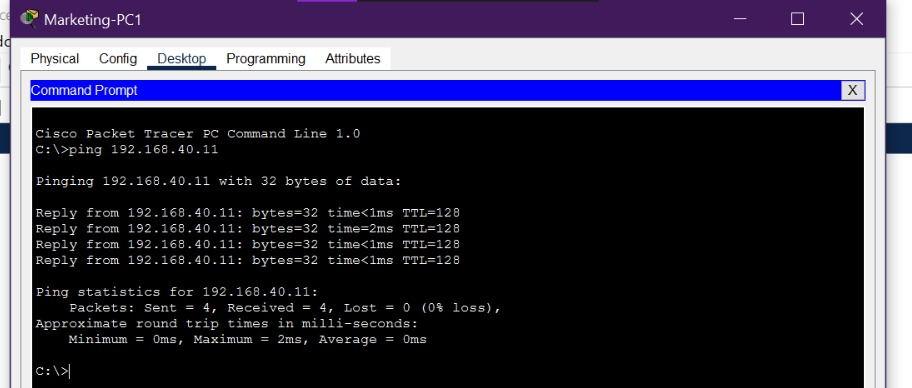
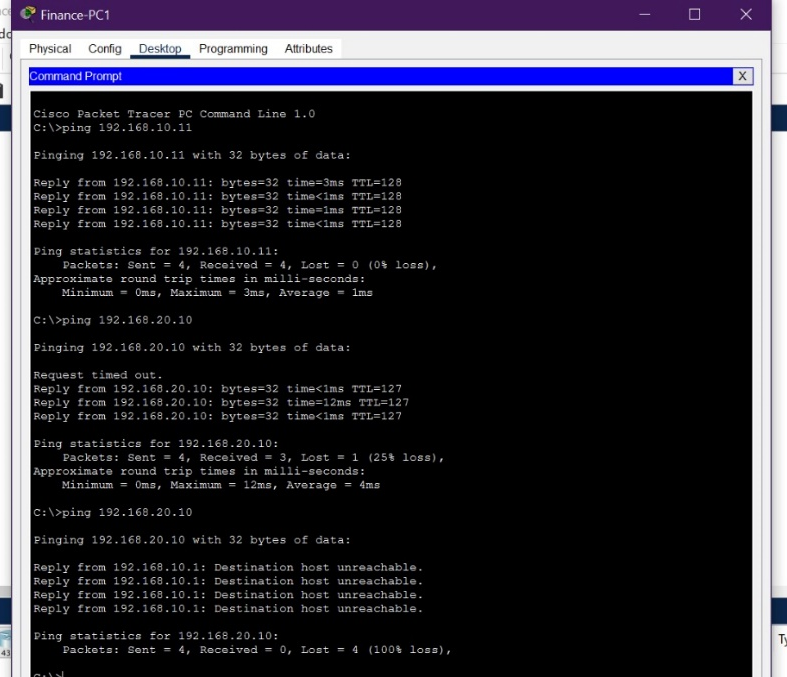

---

## Task 2: Virtual Machine Deployment

An Ubuntu VM (target) and a Kali Linux VM (security workstation) were deployed on the same network, with SSH enabled on the Ubuntu host. Connectivity was confirmed first with a basic `ping`, then with an actual SSH login, deliberately in that order.

**Why ping first:** Checking reachability before attempting authentication isolates the problem if something goes wrong. If ping fails, the issue is networking (routing, firewall, NIC config), no point troubleshooting SSH credentials yet. If ping succeeds but SSH fails, the issue is narrowed to the SSH service itself. This is a basic but genuinely useful troubleshooting discipline: test the simplest layer first.

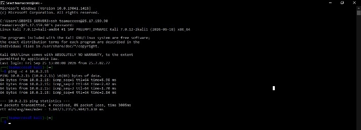
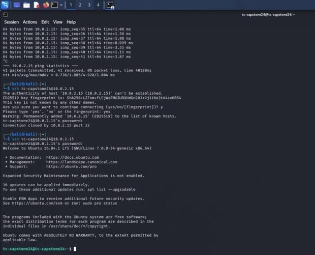

---

## Task 3: Network Reconnaissance (Nmap)

Four scan types were run against the Ubuntu target from Kali: a ping scan (host discovery), a TCP connect scan, a SYN scan, service version detection, and OS detection.

**Why run both a TCP connect scan and a SYN scan:** These use different underlying mechanics — a connect scan completes the full TCP handshake (works without elevated privileges but is more visible to logging), while a SYN scan only sends the first packet and never completes the handshake (needs root, and is quieter/stealthier). Running both and getting identical results is a deliberate cross-check: it confirms the finding isn't an artifact of one specific scan technique.

**What we found:** Only port 22 (SSH) was open, the other 999 scanned ports came back *closed*, not *filtered*. That distinction matters: "closed" means the host actively responded "nothing is listening here," while "filtered" would mean a firewall silently dropped the probe. Closed ports tell you there's no hidden firewall creating false confidence, the host genuinely isn't running anything else.

**The actual risk identified** wasn't "too many open ports" (there was only one), it was that the single open service relied on a shared, non-key-based password, with no IP restriction on who could even attempt to connect. That's the real finding: a single point of entry, with weak gatekeeping around it.

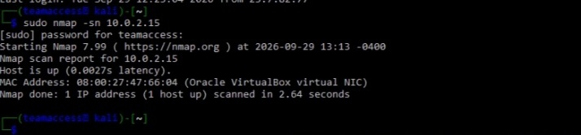
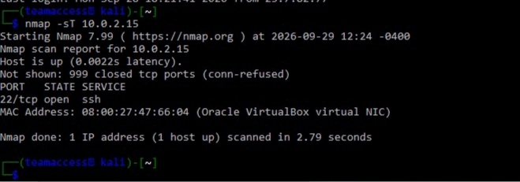
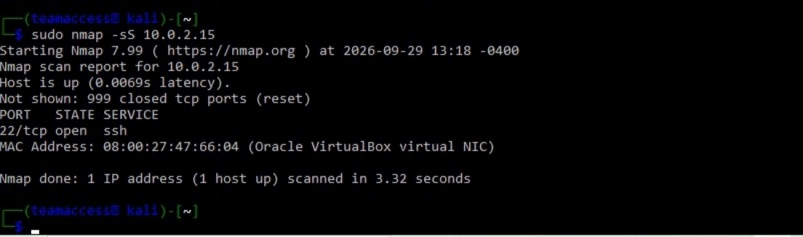
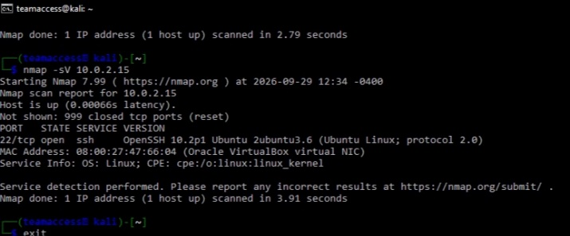
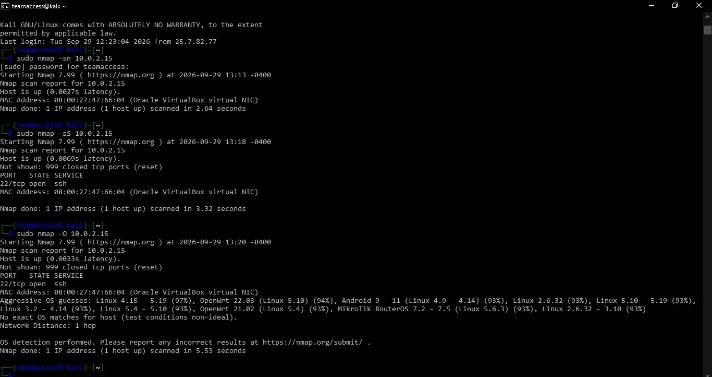

### Findings Summary
| Area | Finding |
|---|---|
| Open ports | Only 22/tcp (SSH) open; all other 999 ports closed, not filtered |
| Service | OpenSSH 10.2p1 on Ubuntu, protocol 2.0 |
| OS | Linux kernel 4.15–5.19 (97% confidence), consistent with the Ubuntu banner from `-sV` |
| Risk 1 | Shared, password-based SSH login, vulnerable to credential compromise or brute-force |
| Risk 2 | No IP allowlist/firewall restriction on who can attempt to connect to port 22 |
| Recommendation 1 | Enforce SSH key-based authentication; set `PasswordAuthentication no` in `sshd_config` |
| Recommendation 2 | Restrict SSH access by firewall rule/IP allowlist (e.g. `ufw allow from <mgmt_IP> to any port 22`) |

---

## Task 4: Packet Analysis (Wireshark)

Three protocols were captured and examined: ICMP, DNS, and HTTP.

**ICMP:** TTL values differ between the outgoing request (64) and the incoming reply (110), a reminder that TTL reflects routing/hop behavior, not a reliable fingerprint of the remote OS on its own.

**DNS:** The plain DNS query for `google.com` was fully visible in the capture, confirming that using HTTPS for the *webpage itself* does nothing to protect the *separate* DNS lookup that resolves its address. This is a distinction worth having clear for an interview: DoH/DoT protect DNS queries in transit; DNSSEC authenticates DNS answers; neither is the same as "the site uses HTTPS."

**HTTP:** A plain-text GET request and its response were fully readable, headers, request line, and body all visible with zero effort, because HTTP applies no encryption at all.

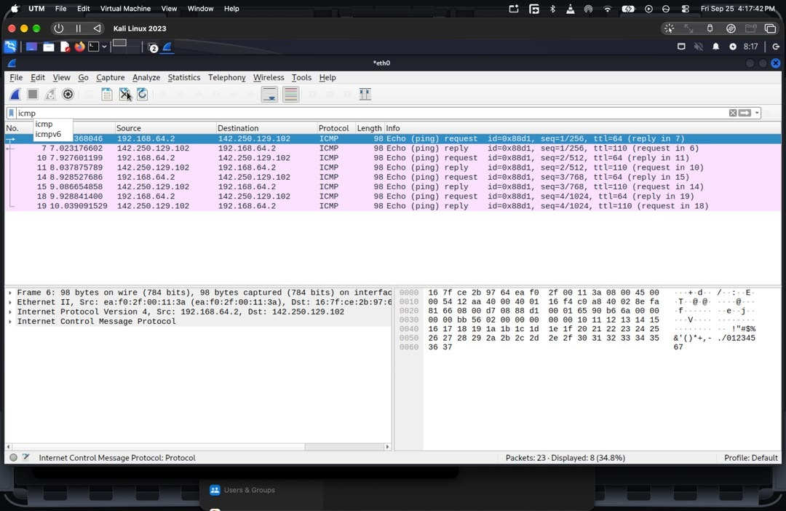
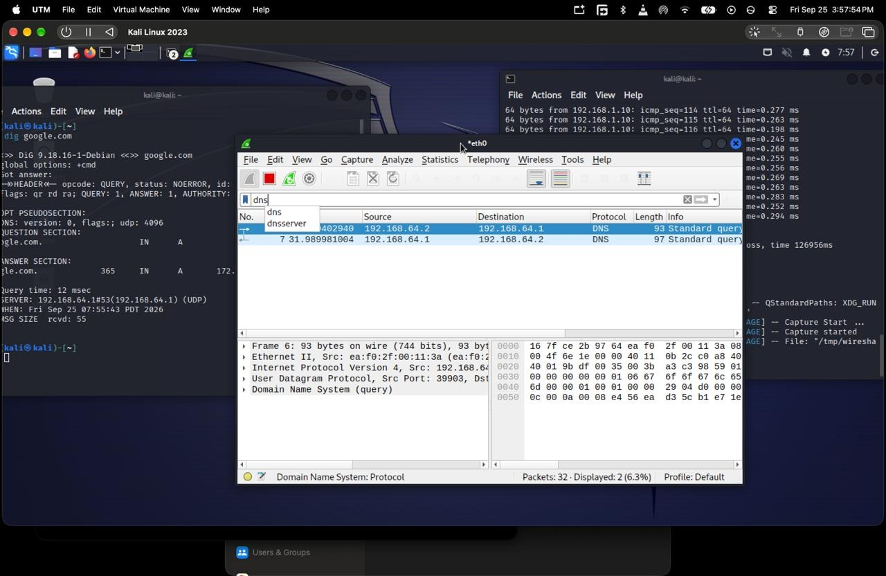
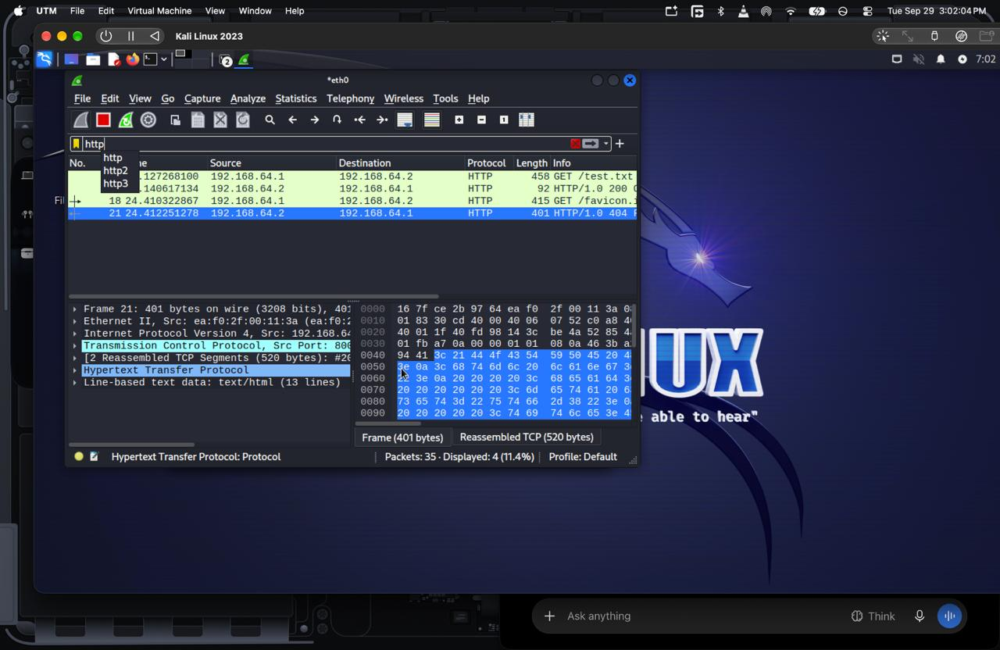

---

## Securing Data Transmission: Encryption, Hashing, and Transfer Comparison

This section used a test file (`secret.txt`, containing "Confidential test data") to demonstrate, not just describe, two different security properties.

### Encryption (confidentiality)
```
openssl enc -aes-256-cbc -salt -in secret.txt -out secret.enc
```
The encrypted output grew from 23 bytes to 48 bytes, consistent with OpenSSL's header, the salt, and AES's 16-byte block padding. More importantly: OpenSSL flagged a real weakness in the command as run, it used a single round of key derivation by default, rather than `-pbkdf2` with a high iteration count. That's a genuine, worth-remembering lesson: using encryption correctly isn't just "run the encrypt command", a weak key-derivation setting makes password-guessing against the encrypted file far easier than it should be.

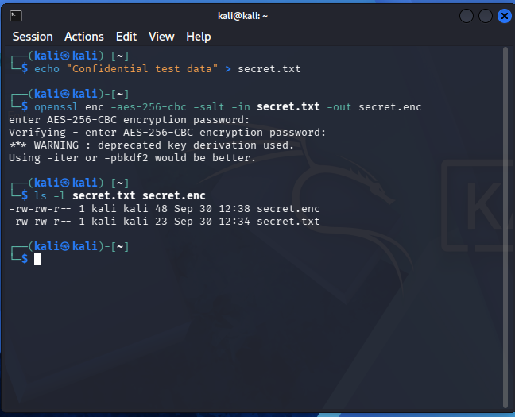

### Hashing (integrity)
```
sha256sum secret.txt
```
Hashing doesn't hide the file's contents, it produces a fingerprint that changes completely if even one character changes later. Encryption and hashing solve *different* problems: encryption stops someone reading the data; hashing lets you detect if the data changed. Confusing the two is a common beginner mistake worth being able to explain clearly in an interview.

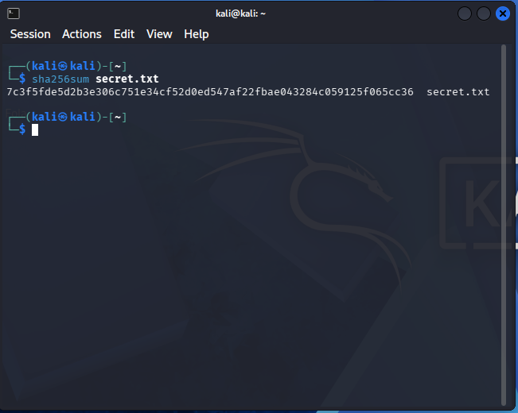

### Secure transfer (SCP) and hash verification
Both files were transferred between two machines using SCP (which runs over SSH), and SHA-256 hashes were recalculated independently on the receiving end.

**Why recompute the hash after transfer, not just trust the transfer succeeded:** A completed file copy doesn't prove the content arrived intact — the hash comparison is what actually proves it. Matching hashes on both ends is the evidence, not an assumption.

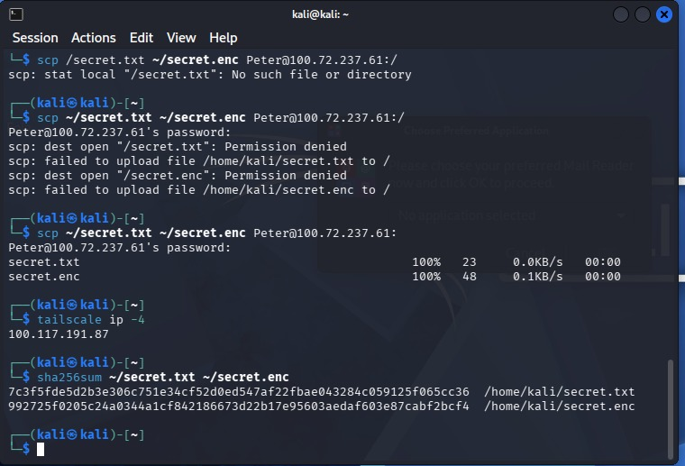
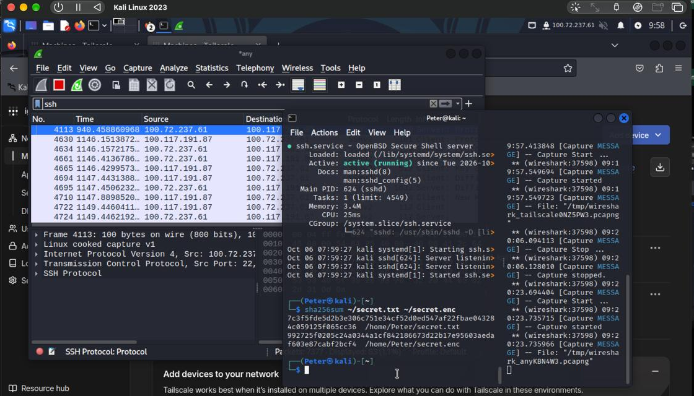
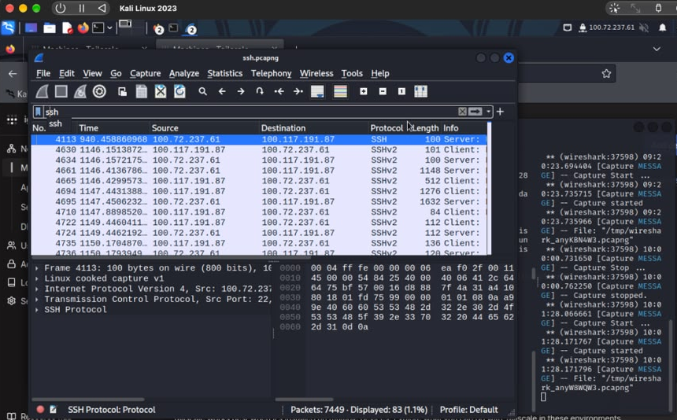

### The core comparison: plaintext (netcat) vs. encrypted (SSH)
The same message was sent twice, once over a raw netcat connection, once over SSH and both were captured in Wireshark.

- **Netcat stream:** "Confidential test data" readable directly in Wireshark, no extra steps.
- **SSH stream:** only the protocol's version-identification banner was readable; the actual session data was encrypted and unreadable.

This is the single clearest piece of evidence in the whole project: the *same information*, sent over two different channels, was either fully exposed or fully protected, not because of anything special done to the data itself, but because of which transport was used.

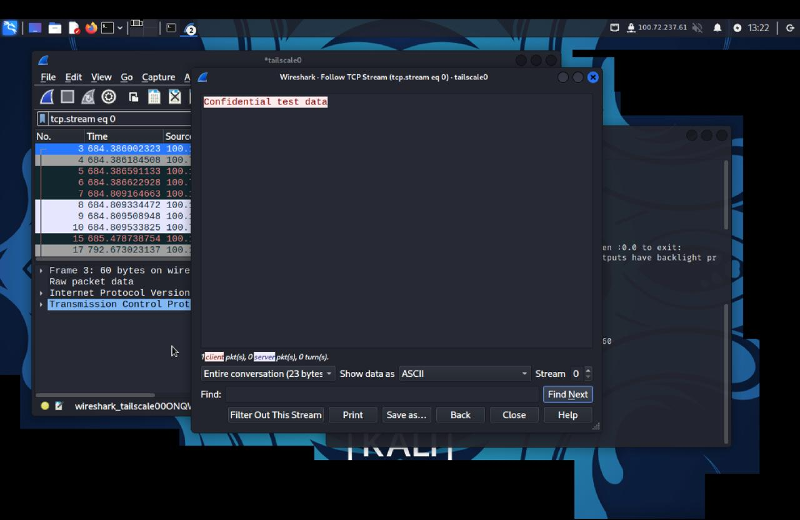
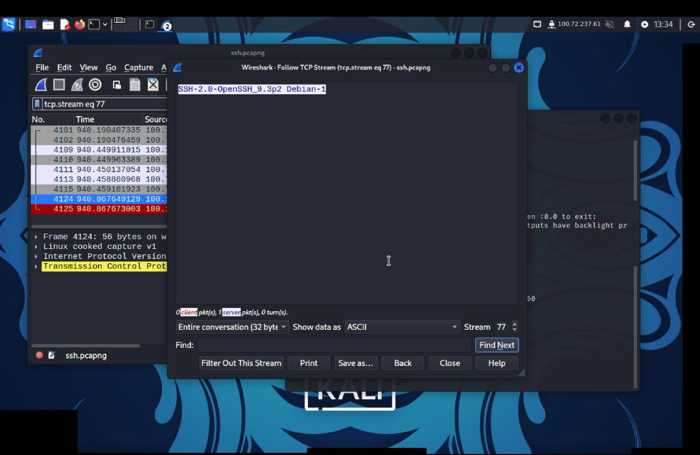

---

## Conclusion and Recommendations

1. Use SFTP/SCP instead of plain FTP, and HTTPS instead of HTTP, for anything sensitive.
2. Encrypt sensitive files at rest using a strong key-derivation setting (`-pbkdf2` with a high `-iter` count) and a strong password not OpenSSL's weak default.
3. Keep a trusted reference SHA-256 hash for important files, and compare against it whenever tampering is suspected.
4. Consider encrypted DNS (DoH/DoT) and monitor for unusual ICMP/DNS volume.
5. Enforce SSH key-based authentication and restrict SSH reachability to known management hosts.

## Note on redactions
Real overlay-network addresses (Tailscale/Hamachi) used by the team during the exercise have been replaced with placeholders in this public version, since they are live addresses tied to real devices rather than disposable lab IPs. Local lab addresses (`10.0.2.15`, `192.168.x.x`) are standard private-range test addresses and are shown as used.
