# Capstone Project: SIEM Deployment (Splunk)

## Overview
This project was completed as part of the TechCrush Cybersecurity Track Cohort 8 capstone, developed collaboratively by an 18-person team (Group 24). The team stood up a Splunk SIEM from scratch, connected Windows and Linux endpoints to it, simulated three real attack techniques against those endpoints, and used the logs generated to perform formal incident triage, including a MITRE ATT&CK-mapped incident report.

## Scenario
The team operated as a newly formed Security Operations Center (SOC) for an organization that had no central visibility into its network activity. The brief: deploy a SIEM from scratch, prove it can actually ingest data from the company's operating systems, and validate that it can detect real attack techniques, not just display logs.

## Tools Used
- Splunk (Manager + Universal Forwarder agents)
- Windows (Security/System/Application Event Logs, PowerShell)
- Linux/Kali (syslog, auth.log)
- MITRE ATT&CK framework (for the formal incident report)

## Skills Demonstrated
SIEM deployment and log forwarding configuration, cross-platform log ingestion (Windows + Linux), attack simulation methodology, Splunk search (SPL) for event triage, Windows Security Event ID interpretation (4720, 4732, 4688), MITRE ATT&CK technique mapping, formal incident report writing.

---

## Phase 1: Infrastructure and Log Ingestion

A central Splunk Manager was deployed, with Universal Forwarder agents installed on both a Windows endpoint and a Kali Linux endpoint, each configured to forward specific log sources back to the Manager on port 9997.

**Why prove ingestion before simulating anything:** if you skip straight to running attacks and only check the SIEM afterward, a failure to see evidence is ambiguous, did the attack not generate a loggable event, or is the SIEM just not receiving data at all? Confirming ingestion first (`Splunk Manager receiving port 9997 enabled`, then actually seeing Windows and Linux event counts in Splunk) establishes a clean baseline, so that anything missing *after* an attack is a real finding, not a plumbing problem.

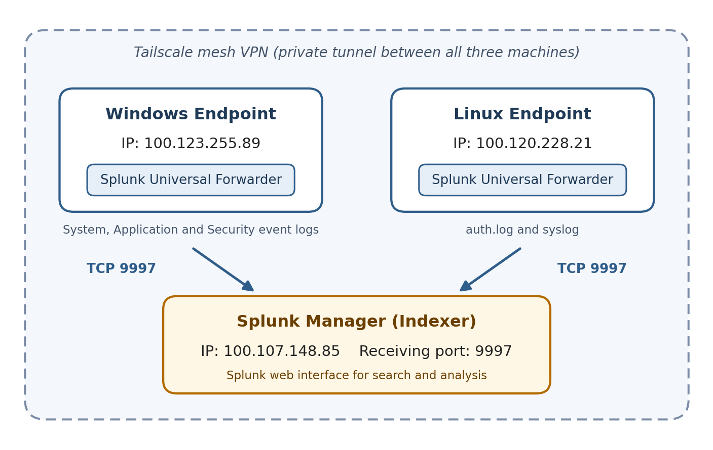
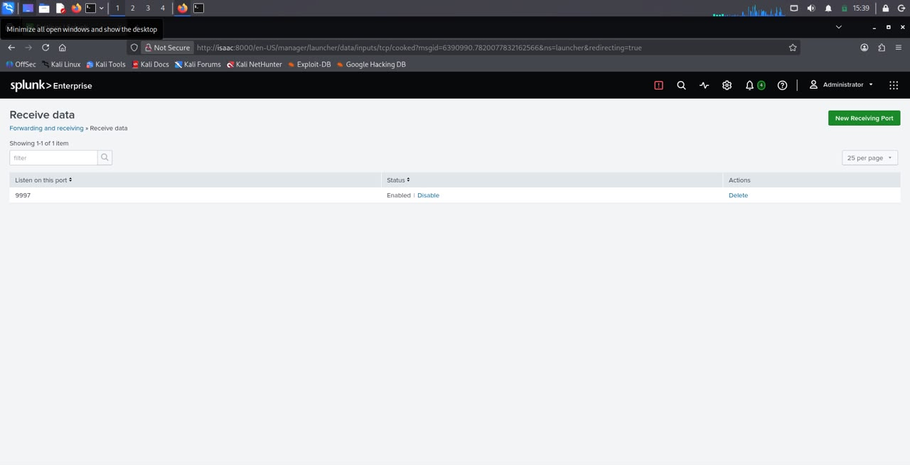
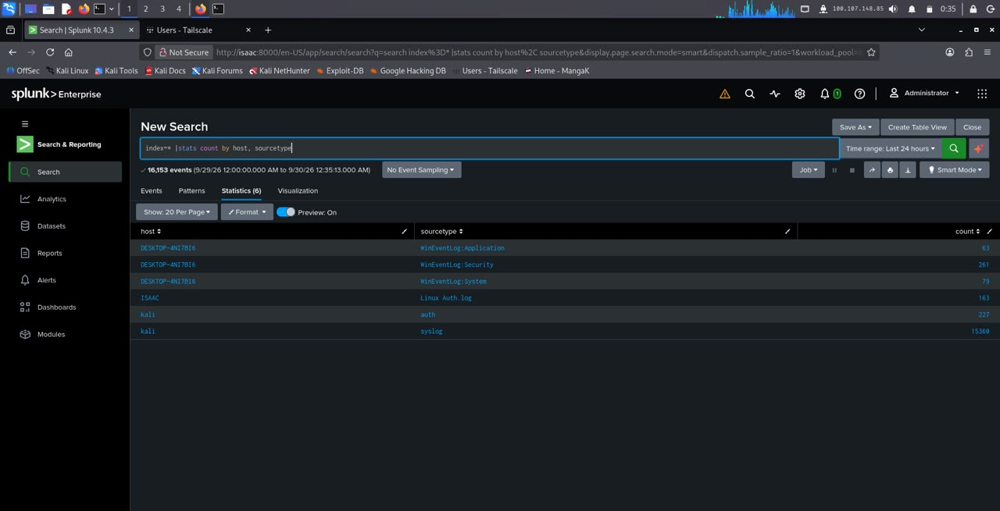
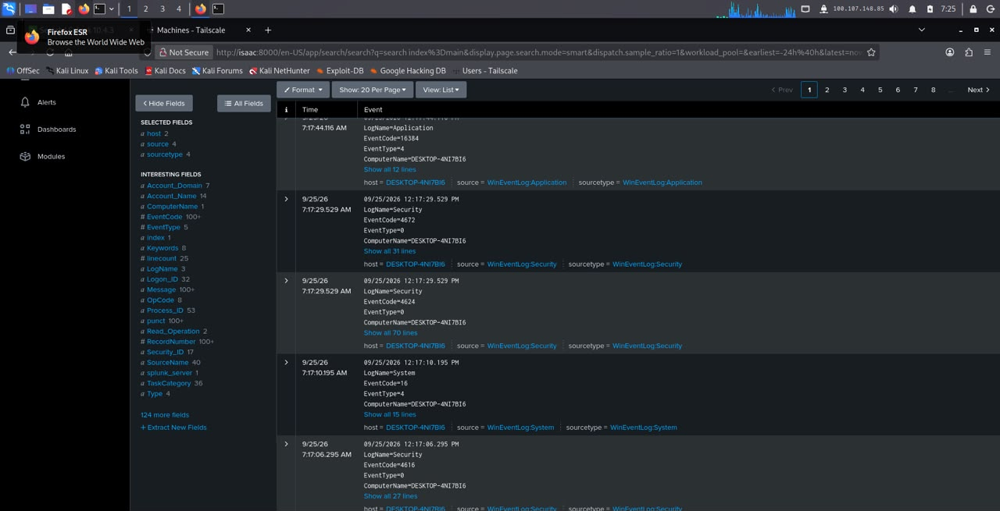
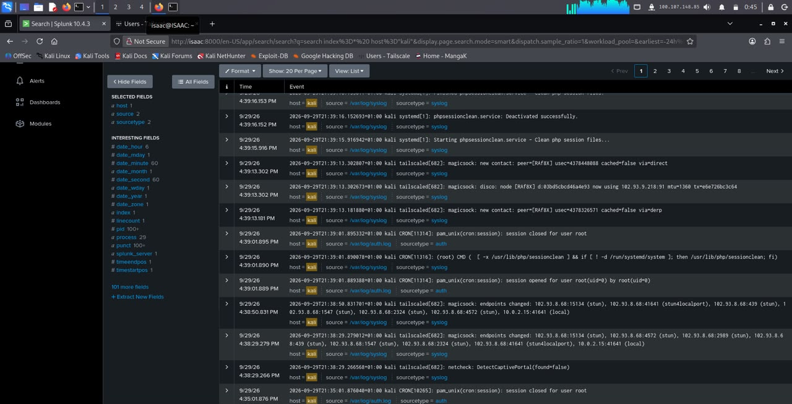

---

## Phase 2: Attack Simulation and Detection

Three real attack techniques were simulated deliberately against the team's own endpoints, specifically to generate the log evidence needed to prove the SIEM could detect them.

### A. Brute-Force Attack on SSH (Linux)
Repeated failed SSH login attempts as a nonexistent user (`baduser`) were run from the Kali terminal, then located in Splunk via a search for failed-password events on the Kali host.

**What this proves:** the SIEM is correctly parsing Linux authentication logs well enough to isolate a specific failure pattern, not just storing raw text.

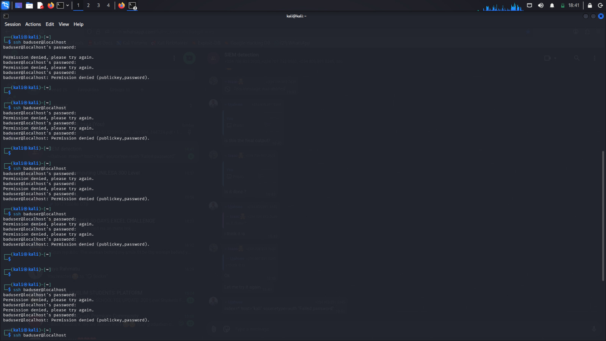
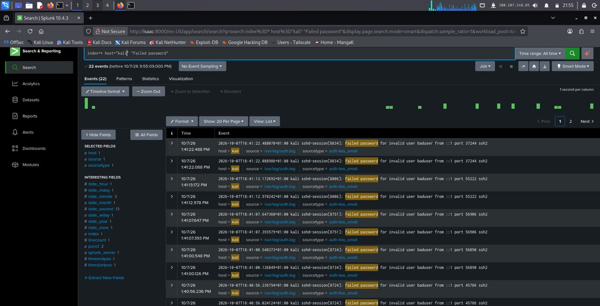

### B. Hidden Local Administrator Account (Windows)
A new local account (`hiddenadmin`) was created via Command Prompt and added to the built-in Administrators group, a classic "create a backdoor account" technique.

**Why this specific technique matters:** it's a two-step attack (create the account, then escalate its privilege by adding it to a privileged group), and both steps generate *separate*, distinctly identifiable Windows Security events — which is exactly what makes this a strong SIEM detection case. One command, one log entry would be less interesting to detect than a multi-step sequence that a SIEM has to correlate.

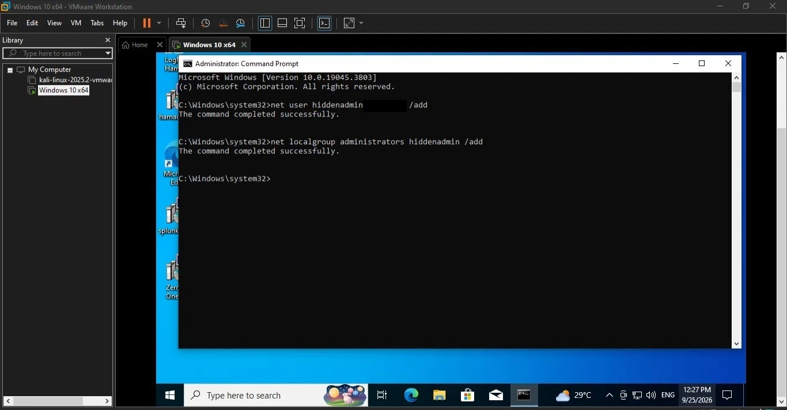
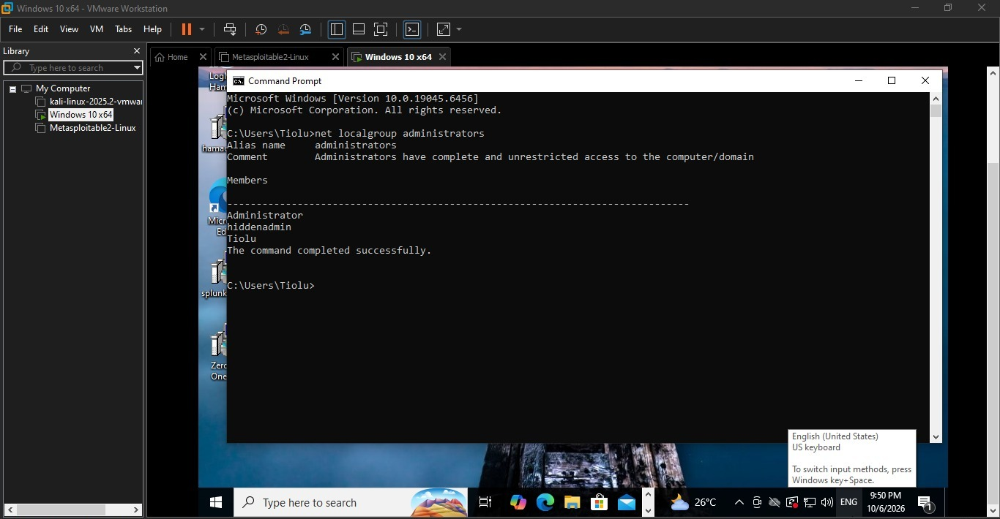
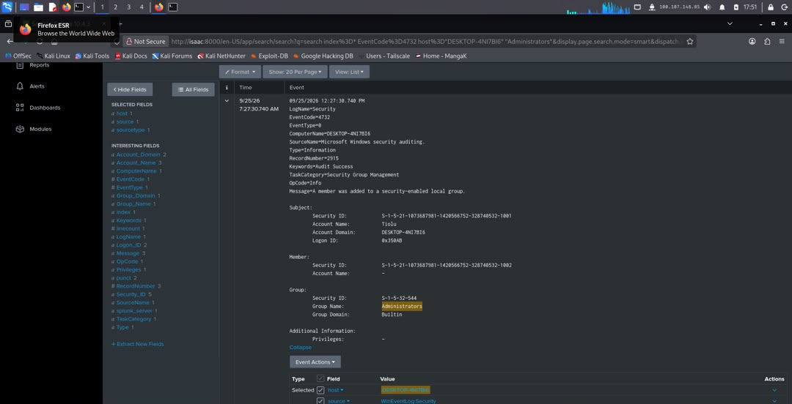
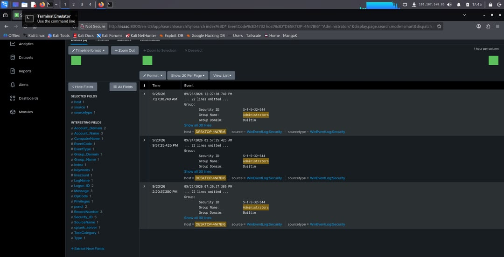
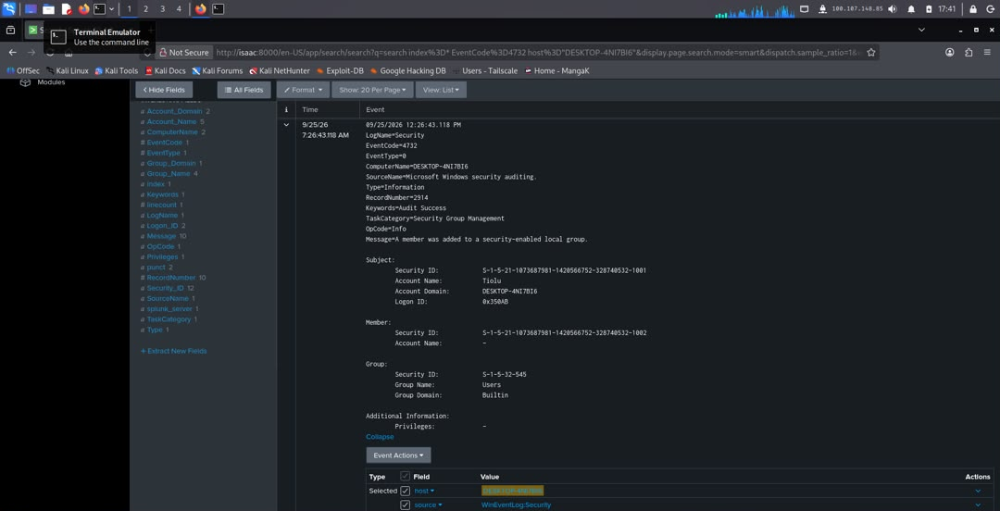
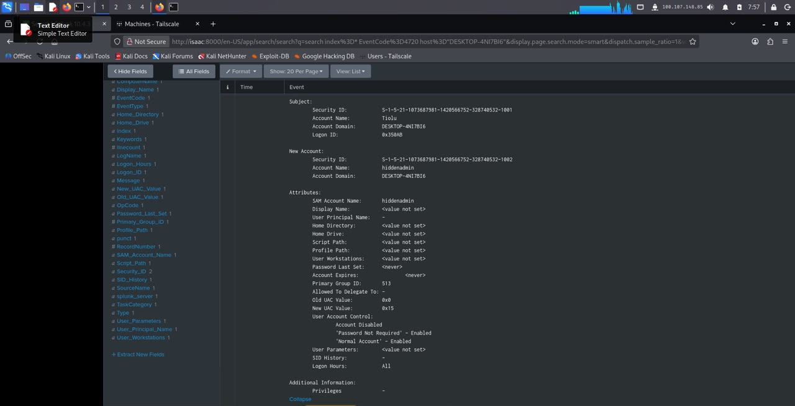
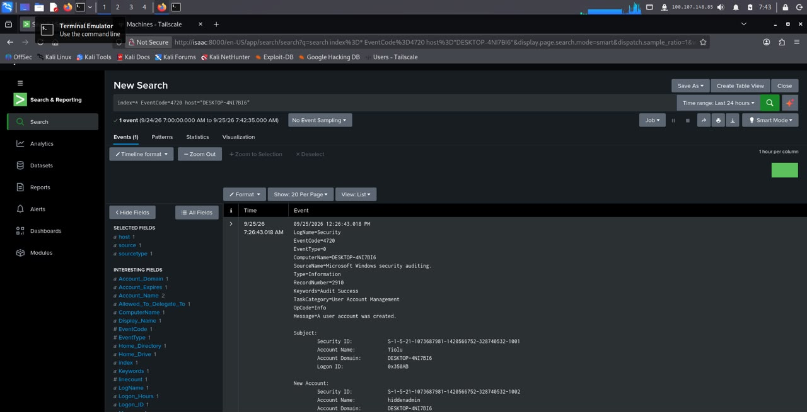

### C. Malicious Command Execution (Windows PowerShell)
Process-creation auditing was enabled, then a PowerShell download command was run — simulating the "use PowerShell to pull an external payload" pattern commonly seen in real intrusions.

**Why auditing has to be turned on first:** this isn't just a lab prerequisite, it mirrors a real-world gap. Many Windows environments don't log process command lines (Event ID 4688 with command-line auditing) by default, which means an attacker's exact PowerShell command can be completely invisible to a SIEM unless this setting is explicitly enabled ahead of time. Simulating it after enabling the setting demonstrates the detection *capability*; it's also a direct, concrete argument for why that setting should be on in a real production environment, not just a lab.

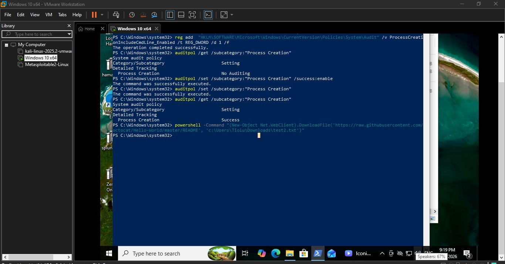
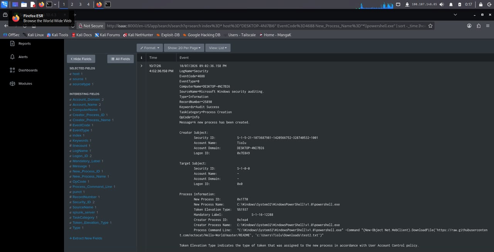

---

## Formal Incident Report

Of the three simulated attacks, the team selected the **hidden local administrator account** for the formal report, because it had the clearest Splunk evidence trail and mapped cleanly to well-documented MITRE ATT&CK techniques.

### MITRE ATT&CK Mapping

| Technique ID | Technique Name | Tactic | Evidence |
|---|---|---|---|
| T1136.001 | Create Account: Local Account | Persistence | Account creation events |
| T1098.007 | Account Manipulation: Additional Local or Domain Groups | Persistence / Privilege Escalation | Group-membership change events |

**Why two techniques apply, not one:** the attack both *created* a new account and *escalated its privilege* by adding it to the built-in Administrators group, two distinct actions, run from the same Command Prompt session, that map to two distinct, named adversary behaviors in the MITRE framework. Being able to name both separately (rather than lumping it all under "suspicious account activity") is exactly the kind of precision a real SOC report is expected to have.

### Raw Log Evidence (transcribed from the Splunk Security events)

**Event 4720, A user account was created:**
```
Subject:
  Security ID:      S-1-5-21-1073687981-1420566752-328740532-1001
  Account Name:      Analyst1
  Account Domain:    DESKTOP-4NI7BI6
New Account:
  Security ID:       S-1-5-21-1073687981-1420566752-328740532-1002
  Account Name:      hiddenadmin
  Account Domain:    DESKTOP-4NI7BI6
```

**Event 4732, A member was added to a security-enabled local group:**
```
EventCode=4732  ComputerName=DESKTOP-4NI7BI6
TaskCategory=Security Group Management
Message=A member was added to a security-enabled local group.
Subject:
  Security ID:   S-1-5-21-1073687981-1420566752-328740532-1001
  Account Name:  Analyst1
Member:
  Security ID:   S-1-5-21-1073687981-1420566752-328740532-1002
Group:
  Security ID:   S-1-5-32-544
  Group Name:    Administrators
  Group Domain:  Builtin
```

### Timeline of the Attack

| # | Date & Time | Event | Evidence |
|---|---|---|---|
| 1 | 25 Sep 2026, 12:26:43 | Local account `hiddenadmin` created via `net user hiddenadmin <password> /add` (Event 4720) | Evidence 08, 13, 14 |
| 2 | 25 Sep 2026, 12:26:43 | `hiddenadmin` added to the Users group (Event 4732) | Evidence 12 |
| 3 | 25 Sep 2026, 12:27:30 | `hiddenadmin` added to the Administrators group via `net localgroup administrators hiddenadmin /add` (Event 4732) | Evidence 08, 10, 11 |
| 4 | 06 Oct 2026 | Manual check on the endpoint confirms `hiddenadmin` is still present in the Administrators group | Evidence 09 |

*Times are the raw local clock times shown in the log text and on the endpoint. Row 4, more than a week after row 3, shows the account was never removed after the exercise, itself a finding, not just a footnote.*

### Technical Recommendations

1. **Alert, don't just search.** Create a Splunk alert on `EventCode=4720` (new local account) and on `EventCode=4732` where the target group is Administrators, so account creation and privilege escalation are flagged as they happen rather than found later by a manual search.
2. **Enforce least privilege and change approval.** Require a documented, approved change before any account is added to a local Administrators group, and review that group's membership on a fixed schedule.
3. **Remove test/exercise accounts promptly.** `hiddenadmin` was still present in the Administrators group more than a week after creation, any account created for an exercise or incident should be removed as soon as it's no longer needed.
4. **Restrict and log account-management commands.** Limit which accounts can run `net user` / `net localgroup` interactively, and route administrative account changes through a logged, approved channel instead of an open Command Prompt session.

---

## Why This Report Structure Matters (Interview-Relevant Reasoning)

This report follows a pattern worth being able to explain on its own: **raw evidence → structured timeline → named technique → actionable recommendation.** Each piece does a different job:
- The raw log snippet is what makes the finding *verifiable*, anyone can re-check it against the actual Splunk event.
- The timeline turns isolated log lines into a *story*, not just "an account was created" but "created, escalated, then left unremediated for over a week."
- The MITRE mapping translates what happened into the *shared vocabulary* the security industry uses, so the finding is understandable to someone who wasn't in the room.
- The recommendations turn the finding into something the organization can actually *act on*, not just acknowledge.

## Files
- `evidence/`, 16 screenshots covering infrastructure setup, log ingestion proof, and all three attack simulations
